# Sequence Diagram Beli Produk Skincare

```mermaid
sequenceDiagram
    actor Pasien
    participant Sistem as Sistem Laravel
    participant Toko as Halaman Toko Produk
    participant Keranjang as Keranjang Belanja
    participant Checkout as Halaman Checkout
    participant DB as Database
    participant Ongkir as API Ongkir Komerce
    participant Midtrans as Payment Gateway Midtrans
    participant WA as Layanan WhatsApp
    participant Admin as Admin/Apoteker

    Pasien->>Sistem: Membuka halaman produk skincare
    Sistem->>DB: Mengambil produk aktif dan kategori produk
    DB-->>Sistem: Data produk tersedia
    Sistem->>Toko: Menampilkan katalog produk
    Toko-->>Pasien: Pasien melihat, mencari, dan memfilter produk

    Pasien->>Toko: Memilih produk dan menambah ke keranjang
    Toko->>Sistem: Kirim data produk dan jumlah
    Sistem->>DB: Cek produk aktif

    alt Produk tidak aktif / tidak ditemukan
        DB-->>Sistem: Produk tidak valid
        Sistem-->>Pasien: Menampilkan pesan produk tidak tersedia
    else Produk valid
        DB-->>Sistem: Produk valid
        Sistem->>Keranjang: Simpan produk ke session keranjang
        Keranjang-->>Pasien: Keranjang berhasil diperbarui
    end

    Pasien->>Keranjang: Membuka keranjang
    Keranjang-->>Pasien: Menampilkan item dan subtotal
    Pasien->>Sistem: Lanjut ke checkout

    alt Keranjang kosong
        Sistem-->>Pasien: Redirect ke toko produk
        Sistem-->>Pasien: Menampilkan pesan keranjang kosong
    else Keranjang berisi produk
        Sistem->>DB: Mengambil profil pasien dan alamat pengiriman

        alt Profil/alamat belum lengkap
            DB-->>Sistem: Data profil atau alamat tidak lengkap
            Sistem-->>Pasien: Redirect ke dashboard profil
            Sistem-->>Pasien: Meminta melengkapi nomor HP dan alamat
        else Profil/alamat lengkap
            DB-->>Sistem: Data profil dan alamat tersedia
            Sistem->>Checkout: Menampilkan halaman checkout
            Checkout-->>Pasien: Menampilkan ringkasan pesanan, alamat, promo, dan pilihan pengiriman

            Pasien->>Checkout: Memilih alamat/kecamatan tujuan
            Checkout->>Sistem: Meminta perhitungan ongkir
            Sistem->>Ongkir: Kirim asal, tujuan, berat, dan kurir

            alt Ongkir gagal dihitung
                Ongkir-->>Sistem: Tidak ada layanan / API gagal
                Sistem-->>Pasien: Menampilkan pesan ongkir tidak tersedia
            else Ongkir berhasil dihitung
                Ongkir-->>Sistem: Daftar layanan kurir dan biaya
                Sistem-->>Pasien: Menampilkan pilihan ongkir
            end

            opt Pasien menggunakan kode promo
                Pasien->>Checkout: Memasukkan kode promo
                Checkout->>Sistem: Validasi kode promo
                Sistem->>DB: Cek promo aktif, periode, dan minimal belanja

                alt Promo tidak valid
                    DB-->>Sistem: Promo tidak ditemukan/tidak aktif/minimal belanja tidak terpenuhi
                    Sistem-->>Pasien: Menampilkan pesan promo tidak valid
                else Promo valid
                    DB-->>Sistem: Promo valid dan diskon dihitung
                    Sistem-->>Pasien: Menampilkan diskon promo
                end
            end

            Pasien->>Sistem: Membuat pesanan checkout
            Sistem->>DB: Cek ulang isi keranjang dan stok produk

            alt Stok produk kurang
                DB-->>Sistem: Stok tidak mencukupi
                Sistem-->>Pasien: Menampilkan pesan gagal memproses pesanan
            else Stok produk cukup
                DB-->>Sistem: Stok tersedia
                Sistem->>DB: Membuat order status "menunggu_pembayaran"
                Sistem->>DB: Menyimpan order item produk
                Sistem->>DB: Mengurangi stok produk
                Sistem->>DB: Menandai stok sudah dikurangi
                DB-->>Sistem: Order berhasil dibuat
                Sistem->>Keranjang: Menghapus session keranjang
                Sistem-->>Pasien: Redirect ke halaman pembayaran

                Pasien->>Sistem: Membuka halaman pembayaran
                Sistem->>DB: Mengambil order dan item order
                DB-->>Sistem: Data order ditemukan

                alt Order bukan milik pasien / status tidak valid
                    Sistem-->>Pasien: Menolak akses atau kembali ke dashboard
                else Order valid dan menunggu pembayaran
                    Sistem->>Midtrans: Meminta Snap Token pembayaran

                    alt Snap Token gagal dibuat
                        Midtrans-->>Sistem: Gagal membuat token
                        Sistem-->>Pasien: Menampilkan pesan pembayaran gagal diproses
                    else Snap Token berhasil dibuat
                        Midtrans-->>Sistem: Snap Token diterima
                        Sistem->>DB: Menyimpan Snap Token pada order
                        Sistem->>Checkout: Menampilkan halaman pembayaran Midtrans
                        Checkout-->>Pasien: Pasien memilih metode pembayaran dan membayar
                    end
                end

                Midtrans->>Sistem: Mengirim webhook status pembayaran
                Sistem->>Sistem: Verifikasi signature key Midtrans

                alt Signature tidak valid
                    Sistem-->>Midtrans: Tolak webhook
                else Signature valid
                    Sistem->>DB: Cari order berdasarkan kode order Midtrans

                    alt Order tidak ditemukan
                        DB-->>Sistem: Order tidak ada
                        Sistem-->>Midtrans: Mengirim respons order not found
                    else Order ditemukan
                        DB-->>Sistem: Data order tersedia

                        alt Pembayaran berhasil
                            Sistem->>DB: Update order menjadi "sudah_dibayar"
                            Sistem->>DB: Simpan metode, channel, referensi, dan waktu bayar
                            Sistem->>DB: Update status pengiriman menjadi "diproses"
                            DB-->>Sistem: Status order berhasil diperbarui
                            Sistem->>WA: Kirim notifikasi pembayaran dikonfirmasi

                            alt WhatsApp gagal
                                WA-->>Sistem: Gagal kirim notifikasi
                                Sistem->>Sistem: Catat log, proses tetap berhasil
                            else WhatsApp berhasil
                                WA-->>Sistem: Notifikasi terkirim
                            end

                            Sistem-->>Pasien: Redirect ke dashboard pesanan
                            Admin-->>Pasien: Pesanan diproses dan dikirim melalui proses admin/apoteker
                        else Pembayaran gagal / expired / dibatalkan
                            Sistem->>DB: Update order menjadi "batal"
                            DB-->>Sistem: Status order dibatalkan
                            Sistem-->>Pasien: Menampilkan status pembayaran gagal atau belum selesai
                        end
                    end
                end
            end
        end
    end
```

Alur beli produk skincare dimulai saat pasien membuka katalog produk, memilih produk aktif, dan menambahkannya ke keranjang. Pasien kemudian melanjutkan checkout, sistem memastikan keranjang tidak kosong serta profil dan alamat pengiriman sudah lengkap. Sistem menghitung ongkir melalui API Komerce, memvalidasi promo jika digunakan, lalu mengecek stok produk sebelum membuat order dan order item. Jika stok cukup, stok produk langsung dikurangi, keranjang dikosongkan, dan pasien diarahkan ke pembayaran Midtrans. Setelah pembayaran diproses, webhook Midtrans memperbarui status order menjadi `sudah_dibayar` atau `batal`, kemudian pesanan yang berhasil dibayar diproses lebih lanjut oleh admin/apoteker.
