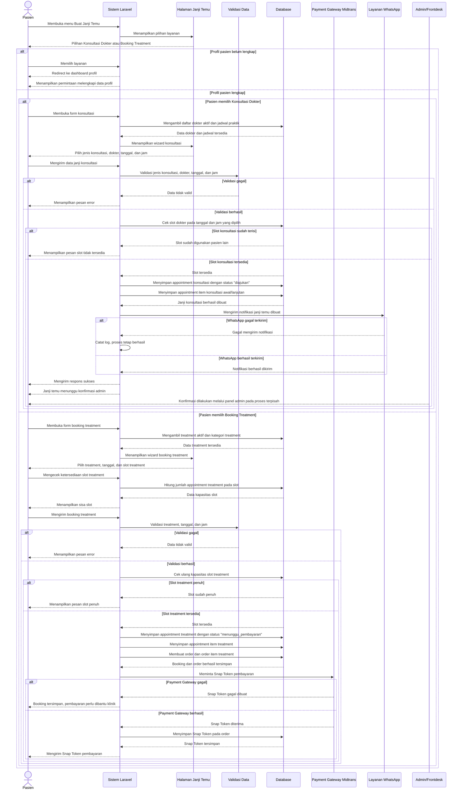

# Sequence Diagram Buat Janji Temu

Alur buat janji temu dimulai saat pasien membuka menu janji temu dan memilih jenis layanan. Jika profil belum lengkap, sistem mengarahkan pasien untuk melengkapi data terlebih dahulu. Pada jalur konsultasi, pasien memilih jenis konsultasi, dokter, tanggal, dan jam; sistem memvalidasi data, memeriksa ketersediaan slot dokter, lalu menyimpan appointment dengan status `diajukan` beserta item konsultasi. Pada jalur treatment, pasien memilih treatment dan slot, sistem memeriksa kapasitas maksimal slot, membuat appointment berstatus `menunggu_pembayaran`, membuat order serta order item, lalu meminta Snap Token ke Midtrans. Jika payment gateway gagal, booking tetap tersimpan tetapi pembayaran perlu dibantu pihak klinik.
