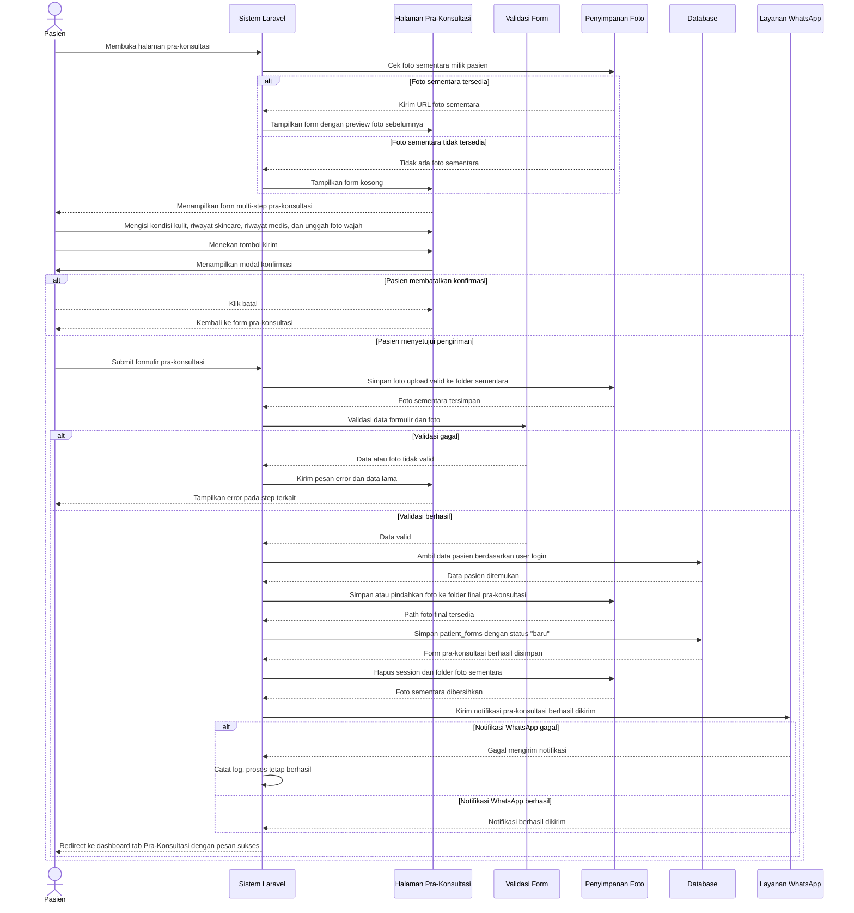

# Sequence Diagram Isi Formulir Pra-Konsultasi

Alur isi formulir pra-konsultasi dimulai saat pasien membuka halaman pra-konsultasi dan sistem menampilkan form multi-step beserta preview foto sementara jika sebelumnya sudah ada upload yang valid. Pasien mengisi data kondisi kulit, riwayat produk, riwayat medis, keluhan utama, serta mengunggah foto wajah. Setelah pasien mengonfirmasi pengiriman, sistem menyimpan foto valid ke penyimpanan sementara, melakukan validasi lengkap, lalu menyimpan data ke tabel `patient_forms` dengan status `baru`. Jika berhasil, foto dipindahkan ke folder final, data sementara dibersihkan, notifikasi WhatsApp dikirim secara best-effort, dan pasien diarahkan ke dashboard tab Pra-Konsultasi.
