# Sequence Diagram Kelola Data Pasien (Admin)

```mermaid
sequenceDiagram
    actor Admin
    participant Sistem as Sistem Filament Admin
    participant Tabel as Halaman Data Pasien
    participant Form as Form Pasien
    participant DB as Database
    participant Storage as Penyimpanan Foto

    Admin->>Sistem: Membuka menu Data Pasien
    Sistem->>DB: Mengambil daftar pasien
    DB-->>Sistem: Data pasien tersedia
    Sistem->>Tabel: Menampilkan tabel data pasien
    Tabel-->>Admin: Menampilkan foto, profil, no rekam medis, identitas, kontak, dan status member

    opt Admin mencari data pasien
        Admin->>Tabel: Mengisi kata kunci nama atau no rekam medis
        Tabel->>Sistem: Mengirim pencarian
        Sistem->>DB: Mencari pasien berdasarkan nama atau no rekam medis

        alt Data tidak ditemukan
            DB-->>Sistem: Tidak ada data pasien sesuai pencarian
            Sistem-->>Admin: Menampilkan hasil kosong
        else Data ditemukan
            DB-->>Sistem: Data pasien sesuai pencarian
            Sistem-->>Admin: Menampilkan hasil pencarian
        end
    end

    alt Admin menambah pasien baru
        Admin->>Tabel: Klik New Pasien
        Tabel->>Form: Menampilkan form tambah pasien
        Form-->>Admin: Input nama, tanggal lahir, jenis kelamin, kontak, member, alamat, dan foto
        Admin->>Sistem: Menyimpan data pasien baru
        Sistem->>Form: Validasi input form pasien

        alt Validasi gagal
            Form-->>Sistem: Data tidak valid
            Sistem-->>Admin: Menampilkan pesan error validasi
        else Validasi berhasil
            Sistem->>DB: Generate nomor rekam medis NM/RM

            opt Admin mengunggah foto profil
                Sistem->>Storage: Menyimpan foto profil pasien
                Storage-->>Sistem: Path foto tersimpan
            end

            Sistem->>DB: Menyimpan data pasien baru
            DB-->>Sistem: Data pasien berhasil dibuat
            Sistem-->>Admin: Menampilkan notifikasi berhasil
            Sistem->>Tabel: Memuat ulang daftar pasien
        end

    else Admin melihat detail pasien
        Admin->>Tabel: Klik ikon lihat detail
        Tabel->>Sistem: Meminta detail pasien
        Sistem->>DB: Mengambil data pasien berdasarkan pasien_id

        alt Data pasien tidak ditemukan
            DB-->>Sistem: Data tidak ada
            Sistem-->>Admin: Menampilkan pesan data tidak ditemukan
        else Data pasien ditemukan
            DB-->>Sistem: Detail pasien tersedia
            Sistem-->>Admin: Menampilkan detail pasien dalam slide-over
        end

    else Admin mengedit data pasien
        Admin->>Tabel: Klik ikon edit pasien
        Tabel->>Sistem: Meminta data pasien untuk diedit
        Sistem->>DB: Mengambil data pasien
        DB-->>Sistem: Data pasien tersedia
        Sistem->>Form: Menampilkan form edit pasien
        Form-->>Admin: Menampilkan data pasien saat ini

        Admin->>Sistem: Menyimpan perubahan data pasien
        Sistem->>Form: Validasi perubahan

        alt Validasi gagal
            Form-->>Sistem: Data tidak valid
            Sistem-->>Admin: Menampilkan pesan error validasi
        else Validasi berhasil
            opt Admin mengubah status menjadi member
                Sistem->>DB: Cek nomor rekam medis pasien
                alt Nomor masih NM
                    Sistem->>DB: Generate nomor rekam medis baru dengan prefix RM
                else Nomor sudah RM
                    Sistem->>DB: Mempertahankan nomor rekam medis
                end
            end

            opt Admin mengganti foto profil
                Sistem->>Storage: Menyimpan foto profil baru
                Storage-->>Sistem: Path foto baru tersimpan
            end

            Sistem->>DB: Update data pasien
            DB-->>Sistem: Data pasien berhasil diperbarui
            Sistem-->>Admin: Menampilkan notifikasi berhasil
            Sistem->>Tabel: Memuat ulang daftar pasien
        end

    else Admin menghapus data pasien
        Admin->>Tabel: Memilih hapus atau bulk delete
        Tabel->>Sistem: Mengirim permintaan hapus data pasien
        Sistem->>DB: Menghapus data pasien terpilih

        alt Data tidak dapat dihapus karena terkait data lain
            DB-->>Sistem: Penghapusan gagal
            Sistem-->>Admin: Menampilkan pesan gagal hapus
        else Penghapusan berhasil
            DB-->>Sistem: Data pasien terhapus
            Sistem-->>Admin: Menampilkan notifikasi berhasil
            Sistem->>Tabel: Memuat ulang daftar pasien
        end
    end
```

Alur kelola data pasien dilakukan oleh admin melalui panel Filament pada menu Data Pasien. Sistem menampilkan daftar pasien beserta foto, profil, nomor rekam medis, identitas, kontak, dan status member. Admin dapat mencari pasien, melihat detail, menambah pasien baru, mengedit data pasien, mengubah status member, mengunggah foto profil, serta menghapus data pasien. Saat pasien baru dibuat atau status member diubah, sistem menghasilkan nomor rekam medis dengan prefix `NM` untuk reguler atau `RM` untuk member. Jika validasi gagal atau data tidak ditemukan, sistem menampilkan pesan kesalahan kepada admin.
