# Sequence Diagram Kelola Data Pengguna

```mermaid
sequenceDiagram
    actor Admin
    participant Sistem as Sistem Laravel / Filament
    participant Halaman as Halaman Data Pengguna Staf
    participant Form as Form Dokter / Terapis
    participant Storage as Penyimpanan Foto
    participant Role as Sistem Role Spatie
    participant DB as Database

    Admin->>Sistem: Membuka menu Data Dokter atau Data Terapis
    Sistem->>DB: Mengambil data profil staf beserta akun user
    DB-->>Sistem: Data dokter/terapis dan user
    Sistem->>Halaman: Menampilkan tabel pengguna staf
    Halaman-->>Admin: Menampilkan foto, nama, kode, kontak, pengalaman/status, dan aksi

    opt Admin mencari atau mengurutkan data
        Admin->>Halaman: Mengisi pencarian / memilih urutan tabel
        Halaman->>Sistem: Mengirim parameter pencarian atau sort
        Sistem->>DB: Query berdasarkan nama user atau kode staf
        DB-->>Sistem: Data pengguna staf sesuai filter
        Sistem-->>Halaman: Memperbarui tabel
    end

    alt Tambah pengguna dokter
        Admin->>Halaman: Klik New Dokter
        Halaman->>Sistem: Meminta form dokter
        Sistem->>Form: Menampilkan form akun dan profil dokter
        Admin->>Form: Mengisi nama, email, telepon, password, pengalaman, status, dan foto
        Form->>Sistem: Mengirim data dokter baru
        Sistem->>Sistem: Validasi data wajib, format email, email unik, dan konfirmasi password

        alt Validasi gagal
            Sistem-->>Form: Mengirim pesan error validasi
            Form-->>Admin: Menampilkan field yang perlu diperbaiki
        else Data valid
            opt Admin mengunggah foto profil
                Sistem->>Storage: Menyimpan foto ke folder dokter

                alt Upload foto gagal
                    Storage-->>Sistem: Foto gagal disimpan
                    Sistem-->>Form: Menampilkan error upload foto
                else Upload foto berhasil
                    Storage-->>Sistem: Path foto berhasil dibuat
                end
            end

            Sistem->>DB: Membuat akun user dokter
            DB-->>Sistem: User berhasil dibuat
            Sistem->>Role: Memberikan role "dokter" ke user
            Role->>DB: Menyimpan relasi user dan role dokter
            DB-->>Role: Role berhasil tersimpan
            Sistem->>DB: Membuat profil dokter dengan kode dokter
            DB-->>Sistem: Profil dokter berhasil dibuat
            Sistem-->>Halaman: Menampilkan notifikasi berhasil
            Halaman-->>Admin: Tabel dokter diperbarui
        end

    else Tambah pengguna terapis
        Admin->>Halaman: Klik New Terapis
        Halaman->>Sistem: Meminta form terapis
        Sistem->>Form: Menampilkan form akun dan profil terapis
        Admin->>Form: Mengisi nama, email, telepon, password, status kerja, dan foto
        Form->>Sistem: Mengirim data terapis baru
        Sistem->>Sistem: Validasi data wajib, format email, email unik, dan konfirmasi password

        alt Validasi gagal
            Sistem-->>Form: Mengirim pesan error validasi
            Form-->>Admin: Menampilkan field yang perlu diperbaiki
        else Data valid
            opt Admin mengunggah foto profil
                Sistem->>Storage: Menyimpan foto ke folder terapis
                Storage-->>Sistem: Path foto berhasil dibuat
            end

            Sistem->>DB: Membuat akun user terapis
            DB-->>Sistem: User berhasil dibuat
            Sistem->>Role: Memberikan role "terapis" ke user
            Role->>DB: Menyimpan relasi user dan role terapis
            DB-->>Role: Role berhasil tersimpan
            Sistem->>DB: Membuat profil terapis dengan kode terapis
            DB-->>Sistem: Profil terapis berhasil dibuat
            Sistem-->>Halaman: Menampilkan notifikasi berhasil
            Halaman-->>Admin: Tabel terapis diperbarui
        end

    else Lihat detail pengguna
        Admin->>Halaman: Klik aksi Detail
        Halaman->>Sistem: Meminta detail dokter/terapis
        Sistem->>DB: Mengambil profil staf dan akun user

        alt Data tidak ditemukan
            DB-->>Sistem: Data tidak tersedia
            Sistem-->>Admin: Menampilkan error data tidak ditemukan
        else Data ditemukan
            DB-->>Sistem: Detail pengguna staf
            Sistem-->>Form: Menampilkan detail dalam slide over
            Form-->>Admin: Menampilkan data akun dan profil
        end

    else Ubah pengguna
        Admin->>Halaman: Klik aksi Edit
        Halaman->>Sistem: Meminta data pengguna staf
        Sistem->>DB: Mengambil profil staf beserta user
        DB-->>Sistem: Data pengguna staf
        Sistem->>Form: Menampilkan form edit
        Admin->>Form: Mengubah nama, email, telepon, password, status, atau foto
        Form->>Sistem: Mengirim perubahan data
        Sistem->>Sistem: Validasi email unik, format data, dan password jika diisi

        alt Validasi gagal
            Sistem-->>Form: Menampilkan pesan error
        else Data valid
            opt Foto diganti
                Sistem->>Storage: Menyimpan foto profil baru
                Storage-->>Sistem: Path foto baru berhasil dibuat
            end

            Sistem->>DB: Memperbarui akun user
            Sistem->>DB: Memperbarui profil dokter/terapis
            DB-->>Sistem: Data berhasil diperbarui
            Sistem-->>Halaman: Menampilkan notifikasi berhasil
            Halaman-->>Admin: Tabel pengguna staf diperbarui
        end

    else Ubah status aktif pengguna
        Admin->>Halaman: Mengubah toggle status praktik/kerja
        Halaman->>Sistem: Mengirim perubahan status
        Sistem->>DB: Memperbarui status_praktik atau status_kerja
        DB-->>Sistem: Status berhasil diperbarui
        Sistem-->>Halaman: Menampilkan status terbaru

        alt Status menjadi nonaktif
            Halaman-->>Admin: Pengguna staf tidak dapat mengakses panel admin
        else Status menjadi aktif
            Halaman-->>Admin: Pengguna staf dapat mengakses panel sesuai role
        end

    else Hapus pengguna staf
        Admin->>Halaman: Memilih hapus data dokter/terapis
        Halaman-->>Admin: Menampilkan konfirmasi penghapusan
        Admin->>Sistem: Mengonfirmasi hapus data
        Sistem->>DB: Menghapus profil dokter/terapis

        alt Data masih digunakan pada appointment atau rekam medis
            DB-->>Sistem: Penghapusan ditolak oleh relasi database
            Sistem-->>Admin: Menampilkan pesan gagal hapus
        else Data berhasil dihapus
            DB-->>Sistem: Profil staf terhapus
            Sistem->>DB: Menghapus akun user terkait karena relasi cascade
            DB-->>Sistem: Akun user dan role terkait ikut terhapus
            Sistem-->>Halaman: Menampilkan notifikasi berhasil
            Halaman-->>Admin: Tabel pengguna staf diperbarui
        end
    end
```

Alur kelola data pengguna pada panel admin berfokus pada pengguna staf, yaitu dokter dan terapis. Admin dapat melihat daftar pengguna staf, menambahkan akun baru, mengisi profil, mengunggah foto, dan sistem otomatis membuat akun pada tabel `users`, memberikan role sesuai jenis pengguna, serta membuat profil pada tabel `dokter` atau `terapis`. Admin juga dapat melihat detail, mengubah data akun dan profil, mengganti password jika diperlukan, mengaktifkan atau menonaktifkan status kerja, serta menghapus data selama tidak terhalang relasi appointment atau rekam medis.
