# Sequence Diagram Kelola Data Produk

```mermaid
sequenceDiagram
    actor Admin
    participant Sistem as Sistem Laravel / Filament
    participant Halaman as Halaman Data Produk
    participant Form as Form Produk
    participant Storage as Penyimpanan Foto
    participant DB as Database

    Admin->>Sistem: Membuka menu Products Catalog pada panel admin
    Sistem->>DB: Mengambil daftar produk beserta kategori
    DB-->>Sistem: Data produk dan kategori
    Sistem->>Halaman: Menampilkan tabel produk
    Halaman-->>Admin: Menampilkan foto, nama, kategori, deskripsi, harga, stok, dan status aktif

    opt Admin mencari, mengurutkan, atau memfilter produk dihapus
        Admin->>Halaman: Mengisi pencarian / sort / filter produk dihapus
        Halaman->>Sistem: Mengirim parameter tabel
        Sistem->>DB: Query produk berdasarkan nama, kategori, status hapus, atau urutan
        DB-->>Sistem: Data produk sesuai filter
        Sistem-->>Halaman: Memperbarui tabel produk
    end

    alt Tambah produk baru
        Admin->>Halaman: Klik tombol New Product
        Halaman->>Sistem: Meminta form tambah produk
        Sistem->>DB: Mengambil daftar kategori produk
        DB-->>Sistem: Data kategori tersedia
        Sistem->>Form: Menampilkan form tambah produk

        opt Admin menambah kategori dari form
            Admin->>Form: Mengisi nama kategori baru
            Form->>Sistem: Mengirim data kategori
            Sistem->>DB: Menyimpan kategori produk
            DB-->>Sistem: Kategori berhasil dibuat
            Sistem-->>Form: Kategori baru otomatis dipilih
        end

        Admin->>Form: Mengisi kategori, nama, deskripsi, harga, berat, stok, tanggal kadaluarsa, foto, dan status aktif
        Form->>Sistem: Mengirim data produk baru
        Sistem->>Sistem: Memvalidasi field wajib dan format data

        alt Validasi gagal
            Sistem-->>Form: Mengirim pesan error validasi
            Form-->>Admin: Menampilkan field yang perlu diperbaiki
        else Kategori tidak valid
            Sistem->>DB: Mengecek kategori produk
            DB-->>Sistem: Kategori tidak ditemukan
            Sistem-->>Form: Menampilkan error kategori tidak valid
        else Data valid
            opt Admin mengunggah foto produk
                Sistem->>Storage: Menyimpan foto ke folder products

                alt Upload foto gagal
                    Storage-->>Sistem: Foto gagal disimpan
                    Sistem-->>Form: Menampilkan error upload foto
                else Upload foto berhasil
                    Storage-->>Sistem: Path foto berhasil dibuat
                end
            end

            Sistem->>DB: Menyimpan data produk
            DB-->>Sistem: Produk berhasil dibuat
            Sistem-->>Halaman: Menampilkan notifikasi berhasil
            Halaman->>DB: Memuat ulang daftar produk
            DB-->>Halaman: Data produk terbaru
            Halaman-->>Admin: Tabel produk diperbarui
        end

    else Ubah produk
        Admin->>Halaman: Klik aksi Edit pada produk
        Halaman->>Sistem: Meminta detail produk
        Sistem->>DB: Mengambil produk berdasarkan ID

        alt Data produk tidak ditemukan
            DB-->>Sistem: Data tidak ada
            Sistem-->>Admin: Menampilkan error data tidak ditemukan
        else Data produk ditemukan
            DB-->>Sistem: Detail produk dan kategori
            Sistem->>Form: Menampilkan form edit produk
            Admin->>Form: Mengubah data produk, stok, status, atau foto
            Form->>Sistem: Mengirim perubahan produk
            Sistem->>Sistem: Memvalidasi perubahan data

            alt Validasi gagal
                Sistem-->>Form: Menampilkan pesan error
            else Data valid
                opt Foto diganti
                    Sistem->>Storage: Menyimpan foto produk baru
                    Storage-->>Sistem: Path foto baru berhasil dibuat
                end

                Sistem->>DB: Memperbarui data produk
                DB-->>Sistem: Produk berhasil diperbarui
                Sistem-->>Halaman: Menampilkan notifikasi berhasil
                Halaman-->>Admin: Tabel produk menampilkan data terbaru
            end
        end

    else Ubah status aktif produk
        Admin->>Halaman: Mengubah toggle status aktif
        Halaman->>Sistem: Mengirim perubahan status
        Sistem->>DB: Memperbarui field is_active
        DB-->>Sistem: Status berhasil diperbarui
        Sistem-->>Halaman: Menampilkan status terbaru

        alt Status menjadi tidak aktif
            Halaman-->>Admin: Produk tidak tampil di katalog pasien
        else Status menjadi aktif
            Halaman-->>Admin: Produk tampil di katalog pasien
        end

    else Hapus produk sementara
        Admin->>Halaman: Klik aksi Delete atau bulk delete
        Halaman-->>Admin: Menampilkan konfirmasi hapus produk
        Admin->>Sistem: Mengonfirmasi hapus
        Sistem->>DB: Mengisi deleted_at pada produk
        DB-->>Sistem: Produk berhasil dihapus sementara
        Sistem-->>Halaman: Menampilkan notifikasi berhasil
        Halaman-->>Admin: Produk berpindah ke filter produk dihapus

    else Restore produk
        Admin->>Halaman: Membuka filter produk dihapus
        Halaman->>Sistem: Meminta data produk terhapus
        Sistem->>DB: Mengambil produk dengan deleted_at terisi
        DB-->>Sistem: Data produk terhapus
        Sistem-->>Halaman: Menampilkan produk terhapus
        Admin->>Halaman: Klik aksi Restore
        Halaman->>Sistem: Mengirim perintah restore
        Sistem->>DB: Mengosongkan deleted_at produk
        DB-->>Sistem: Produk berhasil dipulihkan
        Sistem-->>Halaman: Menampilkan notifikasi berhasil

    else Hapus permanen produk
        Admin->>Halaman: Klik Force Delete pada produk terhapus
        Halaman-->>Admin: Menampilkan konfirmasi hapus permanen
        Admin->>Sistem: Mengonfirmasi hapus permanen
        Sistem->>DB: Menghapus produk secara permanen

        alt Produk masih terhubung dengan order atau bundle
            DB-->>Sistem: Penghapusan ditolak oleh relasi database
            Sistem-->>Admin: Menampilkan pesan gagal hapus permanen
        else Produk berhasil dihapus permanen
            DB-->>Sistem: Produk terhapus permanen
            Sistem-->>Halaman: Menampilkan notifikasi berhasil
            Halaman-->>Admin: Tabel produk diperbarui
        end
    end
```

Alur kelola data produk dilakukan oleh Admin melalui panel Filament pada menu Products Catalog. Sistem menampilkan daftar produk dari database beserta kategori, foto, harga, stok, dan status aktif. Admin dapat menambah produk, membuat kategori produk dari form, mengunggah foto, memperbarui harga dan stok, mengaktifkan atau menonaktifkan produk, menghapus produk sementara dengan soft delete, memulihkan produk, serta menghapus produk permanen jika tidak terhalang relasi order atau bundle. Produk yang aktif dan tidak terhapus akan tampil pada katalog pasien, sedangkan produk nonaktif atau terhapus tidak ditampilkan.
