# Sequence Diagram Kelola Data Treatment

```mermaid
sequenceDiagram
    actor Admin
    participant Sistem as Sistem Laravel / Filament
    participant Halaman as Halaman Data Treatment
    participant Form as Form Treatment
    participant Storage as Penyimpanan Foto
    participant DB as Database

    Admin->>Sistem: Membuka menu Treatment pada panel admin
    Sistem->>DB: Mengambil daftar treatment beserta kategori
    DB-->>Sistem: Data treatment dan kategori
    Sistem->>Halaman: Menampilkan tabel treatment
    Halaman-->>Admin: Menampilkan nama treatment, kategori, deskripsi, harga, durasi, foto, dan status aktif

    opt Admin mencari atau mengurutkan data
        Admin->>Halaman: Mengisi pencarian / memilih urutan tabel
        Halaman->>Sistem: Mengirim parameter pencarian atau sort
        Sistem->>DB: Query treatment berdasarkan nama atau kategori
        DB-->>Sistem: Data treatment sesuai filter
        Sistem-->>Halaman: Memperbarui tabel treatment
    end

    alt Tambah treatment baru
        Admin->>Halaman: Klik tombol Create Treatment
        Halaman->>Sistem: Meminta form tambah treatment
        Sistem->>DB: Mengambil daftar kategori treatment
        DB-->>Sistem: Data kategori tersedia
        Sistem->>Form: Menampilkan form tambah treatment

        opt Admin menambah kategori dari form
            Admin->>Form: Mengisi nama, deskripsi, dan status kategori baru
            Form->>Sistem: Mengirim data kategori
            Sistem->>DB: Menyimpan kategori treatment
            DB-->>Sistem: Kategori berhasil dibuat
            Sistem-->>Form: Kategori baru otomatis dipilih
        end

        Admin->>Form: Mengisi kategori, nama, deskripsi, harga, durasi, foto, dan status aktif
        Form->>Sistem: Mengirim data treatment baru
        Sistem->>Sistem: Memvalidasi field wajib dan format data

        alt Validasi gagal
            Sistem-->>Form: Mengirim pesan error validasi
            Form-->>Admin: Menampilkan field yang perlu diperbaiki
        else Kategori tidak valid
            Sistem->>DB: Mengecek kategori treatment
            DB-->>Sistem: Kategori tidak ditemukan
            Sistem-->>Form: Menampilkan error kategori tidak valid
        else Data valid
            opt Admin mengunggah foto treatment
                Sistem->>Storage: Menyimpan foto ke folder treatments

                alt Upload foto gagal
                    Storage-->>Sistem: Foto gagal disimpan
                    Sistem-->>Form: Menampilkan error upload foto
                else Upload foto berhasil
                    Storage-->>Sistem: Path foto berhasil dibuat
                end
            end

            Sistem->>DB: Menyimpan data treatment
            DB-->>Sistem: Treatment berhasil dibuat
            Sistem-->>Halaman: Menampilkan notifikasi berhasil
            Halaman->>DB: Memuat ulang daftar treatment
            DB-->>Halaman: Data treatment terbaru
            Halaman-->>Admin: Tabel treatment diperbarui
        end

    else Ubah treatment
        Admin->>Halaman: Klik aksi Edit pada treatment
        Halaman->>Sistem: Meminta detail treatment
        Sistem->>DB: Mengambil treatment berdasarkan ID

        alt Data treatment tidak ditemukan
            DB-->>Sistem: Data tidak ada
            Sistem-->>Admin: Menampilkan error data tidak ditemukan
        else Data treatment ditemukan
            DB-->>Sistem: Detail treatment dan kategori
            Sistem->>Form: Menampilkan form edit treatment
            Admin->>Form: Mengubah data treatment atau mengganti foto
            Form->>Sistem: Mengirim perubahan treatment
            Sistem->>Sistem: Memvalidasi perubahan data

            alt Validasi gagal
                Sistem-->>Form: Menampilkan pesan error
            else Data valid
                opt Foto diganti
                    Sistem->>Storage: Menyimpan foto treatment baru
                    Storage-->>Sistem: Path foto baru berhasil dibuat
                end

                Sistem->>DB: Memperbarui data treatment
                DB-->>Sistem: Treatment berhasil diperbarui
                Sistem-->>Halaman: Menampilkan notifikasi berhasil
                Halaman-->>Admin: Tabel treatment menampilkan data terbaru
            end
        end

    else Ubah status aktif treatment
        Admin->>Halaman: Mengubah toggle status aktif
        Halaman->>Sistem: Mengirim perubahan status
        Sistem->>DB: Memperbarui field is_active
        DB-->>Sistem: Status berhasil diperbarui
        Sistem-->>Halaman: Menampilkan status terbaru

        alt Status menjadi tidak aktif
            Halaman-->>Admin: Treatment tidak dapat dipilih pasien pada halaman publik
        else Status menjadi aktif
            Halaman-->>Admin: Treatment dapat tampil dan dipilih pasien
        end

    else Hapus treatment
        Admin->>Halaman: Memilih hapus treatment / bulk delete
        Halaman-->>Admin: Menampilkan konfirmasi penghapusan
        Admin->>Sistem: Mengonfirmasi hapus data
        Sistem->>DB: Menghapus treatment

        alt Treatment masih terhubung dengan data transaksi atau appointment
            DB-->>Sistem: Penghapusan ditolak oleh relasi database
            Sistem-->>Admin: Menampilkan pesan gagal hapus data
        else Treatment berhasil dihapus
            DB-->>Sistem: Data treatment terhapus
            Sistem-->>Halaman: Menampilkan notifikasi berhasil
            Halaman-->>Admin: Tabel treatment diperbarui
        end
    end
```

Alur kelola data treatment dilakukan oleh Admin melalui panel Filament. Sistem menampilkan daftar treatment dari database beserta kategori, foto, harga, durasi, dan status aktif. Admin dapat menambah treatment baru, membuat kategori langsung dari form, mengunggah foto, mengubah data treatment, mengaktifkan atau menonaktifkan treatment, serta menghapus data jika tidak terhalang relasi transaksi atau appointment. Treatment yang aktif akan tersedia pada halaman publik dan flow booking pasien, sedangkan treatment yang tidak aktif tidak ditampilkan untuk dipilih pasien.
