# Sequence Diagram Kelola Jadwal

```mermaid
sequenceDiagram
    actor Admin
    actor Pasien
    participant Sistem as Sistem Laravel / Filament
    participant Halaman as Halaman Jadwal Praktik
    participant Form as Form Jadwal Praktik
    participant DB as Database

    Admin->>Sistem: Membuka menu Jadwal Praktik pada panel admin
    Sistem->>DB: Mengambil daftar jadwal beserta tenaga medis
    DB-->>Sistem: Data jadwal praktik
    Sistem->>Halaman: Menampilkan tabel jadwal
    Halaman-->>Admin: Menampilkan tenaga medis, layanan, hari, jam mulai, jam selesai, dan status aktif

    opt Admin mencari atau mengurutkan jadwal
        Admin->>Halaman: Mengisi pencarian / memilih urutan tabel
        Halaman->>Sistem: Mengirim parameter pencarian atau sort
        Sistem->>DB: Query jadwal berdasarkan tenaga medis, layanan, atau hari
        DB-->>Sistem: Data jadwal sesuai filter
        Sistem-->>Halaman: Memperbarui tabel jadwal
    end

    alt Tambah jadwal praktik
        Admin->>Halaman: Klik New Jadwal Praktik
        Halaman->>Sistem: Meminta form tambah jadwal
        Sistem->>DB: Mengambil dokter dan terapis aktif
        DB-->>Sistem: Daftar tenaga medis aktif
        Sistem->>Form: Menampilkan form jadwal praktik
        Admin->>Form: Memilih tenaga medis, jenis layanan, hari, jam, durasi slot, dan status aktif
        Form->>Sistem: Mengirim data jadwal baru
        Sistem->>Sistem: Memvalidasi field wajib dan format waktu

        alt Validasi gagal
            Sistem-->>Form: Mengirim pesan error validasi
            Form-->>Admin: Menampilkan field yang perlu diperbaiki
        else Tenaga medis tidak valid atau tidak aktif
            Sistem->>DB: Mengecek user dokter/terapis aktif
            DB-->>Sistem: Tenaga medis tidak tersedia
            Sistem-->>Form: Menampilkan error pilihan tenaga medis
        else Data valid
            Sistem->>DB: Menyimpan jadwal praktik
            DB-->>Sistem: Jadwal berhasil dibuat
            Sistem-->>Halaman: Menampilkan notifikasi berhasil
            Halaman-->>Admin: Tabel jadwal diperbarui
        end

    else Lihat detail jadwal
        Admin->>Halaman: Klik aksi Detail
        Halaman->>Sistem: Meminta detail jadwal
        Sistem->>DB: Mengambil jadwal berdasarkan ID

        alt Data jadwal tidak ditemukan
            DB-->>Sistem: Data tidak ada
            Sistem-->>Admin: Menampilkan error data tidak ditemukan
        else Data jadwal ditemukan
            DB-->>Sistem: Detail jadwal praktik
            Sistem-->>Form: Menampilkan detail dalam slide over
            Form-->>Admin: Menampilkan detail jadwal
        end

    else Ubah jadwal praktik
        Admin->>Halaman: Klik aksi Edit
        Halaman->>Sistem: Meminta data jadwal
        Sistem->>DB: Mengambil jadwal dan daftar tenaga medis aktif
        DB-->>Sistem: Data jadwal dan tenaga medis
        Sistem->>Form: Menampilkan form edit jadwal
        Admin->>Form: Mengubah tenaga medis, layanan, hari, jam, durasi slot, atau status
        Form->>Sistem: Mengirim perubahan jadwal
        Sistem->>Sistem: Memvalidasi perubahan data

        alt Validasi gagal
            Sistem-->>Form: Menampilkan pesan error
        else Data valid
            Sistem->>DB: Memperbarui jadwal praktik
            DB-->>Sistem: Jadwal berhasil diperbarui
            Sistem-->>Halaman: Menampilkan notifikasi berhasil
            Halaman-->>Admin: Tabel jadwal menampilkan data terbaru
        end

    else Hapus jadwal praktik
        Admin->>Halaman: Memilih hapus jadwal / bulk delete
        Halaman-->>Admin: Menampilkan konfirmasi penghapusan
        Admin->>Sistem: Mengonfirmasi hapus jadwal
        Sistem->>DB: Menghapus jadwal praktik

        alt Jadwal masih terhubung dengan data yang dibatasi relasi
            DB-->>Sistem: Penghapusan ditolak
            Sistem-->>Admin: Menampilkan pesan gagal hapus
        else Jadwal berhasil dihapus
            DB-->>Sistem: Jadwal terhapus
            Sistem-->>Halaman: Menampilkan notifikasi berhasil
            Halaman-->>Admin: Tabel jadwal diperbarui
        end
    end

    opt Jadwal digunakan pada booking konsultasi pasien
        Pasien->>Sistem: Membuka halaman buat janji konsultasi
        Sistem->>DB: Mengambil dokter aktif dan jadwal praktik aktif
        DB-->>Sistem: Data dokter dan jadwal aktif
        Sistem-->>Pasien: Menampilkan pilihan dokter, tanggal, dan slot sesuai jadwal

        Pasien->>Sistem: Mengecek slot konsultasi dokter
        Sistem->>DB: Mengambil appointment pada dokter dan tanggal tersebut
        DB-->>Sistem: Daftar jam yang sudah terisi
        Sistem-->>Pasien: Menampilkan slot tersedia dan slot yang sudah terisi

        alt Slot sudah terisi
            Pasien->>Sistem: Mengirim booking pada slot yang sudah dipakai
            Sistem->>DB: Mengecek appointment aktif pada slot tersebut
            DB-->>Sistem: Slot sudah digunakan
            Sistem-->>Pasien: Menampilkan pesan slot tidak tersedia
        else Slot tersedia
            Pasien->>Sistem: Mengirim booking pada slot tersedia
            Sistem->>DB: Menyimpan appointment konsultasi
            DB-->>Sistem: Appointment berhasil dibuat
            Sistem-->>Pasien: Menampilkan informasi janji temu berhasil diajukan
        end
    end
```

Alur kelola jadwal dilakukan oleh Admin melalui panel Filament pada menu Jadwal Praktik. Sistem menampilkan daftar jadwal tenaga medis, lalu Admin dapat menambah, melihat detail, mengubah, atau menghapus jadwal berdasarkan tenaga medis aktif, jenis layanan, hari, jam praktik, durasi slot, dan status aktif. Jadwal yang aktif digunakan sistem saat pasien membuat janji konsultasi, sehingga pasien hanya melihat slot berdasarkan jadwal praktik yang tersedia dan sistem tetap mengecek appointment yang sudah terisi sebelum booking disimpan.
