# Sequence Diagram Kelola Transaksi

```mermaid
sequenceDiagram
    actor Admin
    actor Pasien
    participant Sistem as Sistem Laravel / Filament
    participant Halaman as Halaman Transaksi
    participant Form as Form Transaksi / Modal Aksi
    participant Stok as Service Stok Produk
    participant Invoice as Service Invoice
    participant Notifikasi as Notifikasi Email / WhatsApp
    participant Midtrans as Payment Gateway Midtrans
    participant DB as Database

    Admin->>Sistem: Membuka menu Transaksi pada panel admin
    Sistem->>DB: Mengambil daftar order beserta pasien, item, promo, dan status
    DB-->>Sistem: Data transaksi
    Sistem->>Halaman: Menampilkan tabel transaksi
    Halaman-->>Admin: Menampilkan kode order, pelanggan, item, tagihan, pembayaran, pengiriman, dan status

    opt Admin mencari atau memfilter transaksi
        Admin->>Halaman: Mengisi pencarian / filter status pembayaran / filter status pengiriman
        Halaman->>Sistem: Mengirim parameter filter
        Sistem->>DB: Query order berdasarkan kode, pasien, status, atau pengiriman
        DB-->>Sistem: Data transaksi sesuai filter
        Sistem-->>Halaman: Memperbarui tabel transaksi
    end

    alt Buat transaksi offline / POS
        Admin->>Halaman: Klik New Transaksi
        Halaman->>Sistem: Meminta form transaksi baru
        Sistem->>DB: Mengambil daftar pasien, produk, treatment, bundle, dan promo aktif
        DB-->>Sistem: Data master transaksi
        Sistem->>Form: Menampilkan form POS

        opt Admin menambah pasien baru dari form
            Admin->>Form: Mengisi data pasien baru
            Form->>Sistem: Mengirim data pasien
            Sistem->>DB: Membuat user pasien dan profil pasien
            DB-->>Sistem: Pasien baru berhasil dibuat
            Sistem-->>Form: Pasien baru otomatis dipilih
        end

        Admin->>Form: Memilih pasien, item transaksi, qty, diskon, promo, dan metode pembayaran
        Form->>Sistem: Mengirim transaksi
        Sistem->>Sistem: Validasi pasien, item, qty, harga, promo, dan pembayaran

        alt Validasi gagal
            Sistem-->>Form: Mengirim pesan error validasi
            Form-->>Admin: Menampilkan field yang perlu diperbaiki
        else Promo tidak valid
            Sistem->>DB: Mengecek kode promo
            DB-->>Sistem: Promo tidak ditemukan / tidak aktif / subtotal kurang
            Sistem-->>Form: Menampilkan pesan promo tidak dapat digunakan
        else Nominal cash kurang
            Sistem-->>Form: Menampilkan pesan nominal pembayaran kurang
        else Data valid
            Sistem->>DB: Menyimpan order dan order_items
            DB-->>Sistem: Transaksi berhasil dibuat
            Sistem->>Stok: Mengurangi stok untuk item produk atau bundle
            Stok->>DB: Update stok produk dan flag is_stock_deducted
            DB-->>Stok: Stok berhasil disesuaikan
            Sistem-->>Halaman: Menampilkan notifikasi pembayaran berhasil
            Halaman-->>Admin: Menampilkan opsi Cetak Struk
        end

    else Lihat detail invoice
        Admin->>Halaman: Klik aksi Lihat Detail Invoice
        Halaman->>Sistem: Meminta detail order
        Sistem->>DB: Mengambil order, pasien, item produk, treatment, bundle, dan konsultasi
        DB-->>Sistem: Detail invoice
        Sistem-->>Form: Menampilkan slide-over invoice
        Form-->>Admin: Menampilkan rincian pelanggan, transaksi, item, subtotal, dan total

    else Cetak invoice / struk
        Admin->>Halaman: Klik aksi Cetak Invoice
        Halaman->>Sistem: Membuka halaman print invoice
        Sistem->>DB: Mengambil data order
        DB-->>Sistem: Detail order
        Sistem->>Invoice: Render teks struk
        Invoice-->>Sistem: Konten struk siap cetak
        Sistem-->>Admin: Menampilkan halaman cetak struk

    else Konfirmasi pembayaran manual
        Admin->>Halaman: Klik aksi Konfirmasi Pembayaran
        Halaman->>Sistem: Meminta modal konfirmasi pembayaran
        Sistem->>DB: Mengambil ringkasan order dan item
        DB-->>Sistem: Data tagihan
        Sistem->>Form: Menampilkan modal pembayaran
        Admin->>Form: Memilih metode pembayaran dan mengisi nominal bayar
        Form->>Sistem: Mengirim konfirmasi lunas
        Sistem->>Sistem: Validasi metode pembayaran, diskon, dan nominal cash

        alt Metode pembayaran belum dipilih
            Sistem-->>Form: Menampilkan error metode pembayaran wajib
        else Nominal pembayaran kurang
            Sistem-->>Form: Menampilkan error nominal pembayaran kurang
        else Pembayaran valid
            Sistem->>DB: Update status order menjadi sudah_dibayar dan isi paid_at
            DB-->>Sistem: Status pembayaran tersimpan
            Sistem->>Stok: Mengurangi stok produk jika belum pernah dipotong
            Stok->>DB: Update stok dan is_stock_deducted secara idempotent
            DB-->>Stok: Stok berhasil disesuaikan
            Sistem->>DB: Mengaktifkan membership jika order memenuhi syarat konsultasi/member
            DB-->>Sistem: Status membership diperbarui jika eligible
            Sistem->>Notifikasi: Mengirim notifikasi pembayaran dikonfirmasi
            Notifikasi-->>Sistem: Notifikasi diproses
            Sistem-->>Halaman: Menampilkan notifikasi pembayaran berhasil dikonfirmasi
        end

    else Update nomor resi
        Admin->>Halaman: Klik aksi Input / Update Nomor Resi
        Halaman->>Sistem: Meminta modal resi

        alt Order bukan produk online atau sudah dikirim
            Sistem-->>Halaman: Aksi resi tidak ditampilkan
        else Order produk sudah dibayar dan belum memiliki resi
            Sistem->>Form: Menampilkan form nomor resi
            Admin->>Form: Mengisi nomor resi
            Form->>Sistem: Menyimpan nomor resi
            Sistem->>DB: Update shipping_waybill dan shipping_status menjadi dikirim
            DB-->>Sistem: Data pengiriman tersimpan
            Sistem->>Notifikasi: Mengirim notifikasi pengiriman ke pasien
            Notifikasi-->>Sistem: Notifikasi diproses
            Sistem-->>Halaman: Menampilkan notifikasi resi berhasil disimpan
        end

    else Batalkan pesanan langsung
        Admin->>Halaman: Memilih aksi Batalkan Pesanan
        Halaman->>Form: Menampilkan modal alasan pembatalan
        Admin->>Form: Mengisi alasan opsional dan konfirmasi
        Form->>Sistem: Mengirim pembatalan pesanan
        Sistem->>DB: Lock order untuk mencegah proses ganda

        alt Order sudah dibatalkan / sudah dibayar
            DB-->>Sistem: Status tidak dapat dibatalkan langsung
            Sistem-->>Admin: Menampilkan pesan pesanan sudah diproses
        else Order dapat dibatalkan
            Sistem->>Stok: Mengembalikan stok produk yang pernah dipotong
            Stok->>DB: Update stok produk dan reset is_stock_deducted
            DB-->>Stok: Stok berhasil dikembalikan
            Sistem->>DB: Update status order menjadi batal dan pengiriman dibatalkan
            DB-->>Sistem: Status order tersimpan
            Sistem->>Notifikasi: Mengirim notifikasi pembatalan ke pasien
            Notifikasi-->>Sistem: Notifikasi diproses
            Sistem-->>Halaman: Menampilkan notifikasi pesanan dibatalkan
        end

    else Setujui pengajuan pembatalan pasien
        Pasien->>Sistem: Mengajukan pembatalan order
        Sistem->>DB: Update status order menjadi cancel_requested
        DB-->>Sistem: Pengajuan pembatalan tersimpan
        Admin->>Halaman: Klik Setujui Pembatalan
        Halaman->>Sistem: Mengirim persetujuan pembatalan
        Sistem->>DB: Lock order dan cek status cancel_requested

        alt Status sudah berubah
            DB-->>Sistem: Order bukan cancel_requested
            Sistem-->>Admin: Menampilkan pesan pembatalan sudah diproses
        else Status masih cancel_requested
            Sistem->>Stok: Mengembalikan stok produk secara aman dari double restore
            Stok->>DB: Update stok produk dan reset is_stock_deducted
            DB-->>Stok: Stok berhasil dikembalikan
            Sistem->>DB: Update order menjadi batal dan pengiriman dibatalkan
            DB-->>Sistem: Status pembatalan tersimpan
            Sistem->>Notifikasi: Mengirim notifikasi pembatalan disetujui
            Notifikasi-->>Sistem: Notifikasi diproses
            Sistem-->>Halaman: Menampilkan notifikasi pembatalan disetujui
        end

    else Tolak pengajuan pembatalan pasien
        Admin->>Halaman: Klik Tolak Pembatalan
        Halaman->>Sistem: Mengirim penolakan pembatalan
        Sistem->>DB: Update status order kembali menjadi menunggu_pembayaran
        DB-->>Sistem: Status order tersimpan
        Sistem->>Notifikasi: Mengirim notifikasi pembatalan ditolak
        Notifikasi-->>Sistem: Notifikasi diproses
        Sistem-->>Halaman: Menampilkan notifikasi pengajuan pembatalan ditolak
    end

    opt Pembayaran online melalui Midtrans
        Pasien->>Sistem: Membuka halaman pembayaran order
        Sistem->>Midtrans: Meminta Snap Token

        alt Snap Token gagal dibuat
            Midtrans-->>Sistem: Error payment gateway
            Sistem-->>Pasien: Menampilkan pesan gagal memproses pembayaran
        else Snap Token tersedia
            Midtrans-->>Sistem: Snap Token
            Sistem->>DB: Menyimpan snap_token pada order
            DB-->>Sistem: Token tersimpan
            Sistem-->>Pasien: Menampilkan halaman pembayaran Midtrans
        end

        Midtrans->>Sistem: Mengirim webhook status pembayaran
        Sistem->>Sistem: Verifikasi signature webhook

        alt Signature tidak valid
            Sistem-->>Midtrans: Tolak webhook
        else Pembayaran settlement / capture berhasil
            Sistem->>DB: Update order menjadi sudah_dibayar dan simpan referensi pembayaran
            DB-->>Sistem: Pembayaran tersimpan
            Sistem->>DB: Update appointment terkait jika order treatment
            DB-->>Sistem: Appointment disetujui jika ada
            Sistem->>DB: Aktivasi membership jika eligible
            DB-->>Sistem: Membership diperbarui jika memenuhi syarat
            Sistem->>Notifikasi: Mengirim notifikasi pembayaran berhasil
            Notifikasi-->>Sistem: Notifikasi diproses
            Sistem-->>Midtrans: Response success
        else Pembayaran cancel / deny / expired
            Sistem->>DB: Update order menjadi batal
            Sistem->>DB: Batalkan appointment treatment terkait jika masih menunggu pembayaran
            DB-->>Sistem: Order dan appointment dibatalkan
            Sistem-->>Midtrans: Response success
        end
    end
```

Alur kelola transaksi dilakukan oleh Admin melalui panel Filament pada menu Transaksi. Sistem menampilkan daftar order lengkap dengan pasien, item, tagihan, status pembayaran, dan status pengiriman. Admin dapat membuat transaksi POS, melihat detail invoice, mencetak struk, mengonfirmasi pembayaran manual, mengisi nomor resi untuk order produk online, membatalkan pesanan, serta menyetujui atau menolak pengajuan pembatalan dari pasien. Pada setiap perubahan status penting, sistem memperbarui database, menyesuaikan stok produk secara aman menggunakan flag `is_stock_deducted`, mengaktifkan membership jika memenuhi syarat, dan mengirim notifikasi. Untuk pembayaran online, Midtrans mengirim webhook yang diverifikasi sebelum order diperbarui menjadi lunas atau batal.
