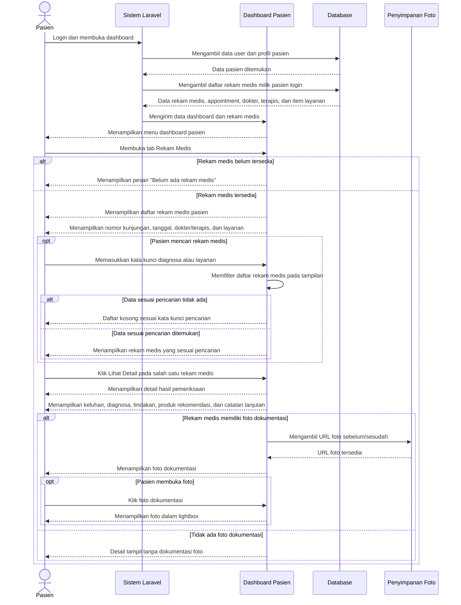

# Sequence Diagram Lihat Rekam Medis dari Sisi Pasien

Alur lihat rekam medis dari sisi pasien dimulai ketika pasien membuka dashboard. Sistem mengambil data pasien login dan daftar rekam medis yang terkait dengan `pasien_id` milik user tersebut, termasuk relasi appointment, dokter, terapis, dan layanan yang dilakukan. Jika belum ada rekam medis, dashboard menampilkan pesan kosong. Jika data tersedia, pasien dapat melihat daftar rekam medis, mencari berdasarkan diagnosa atau layanan, membuka detail hasil pemeriksaan, melihat keluhan, diagnosa, tindakan, produk rekomendasi, catatan lanjutan, serta membuka dokumentasi foto sebelum/sesudah jika tersedia.
