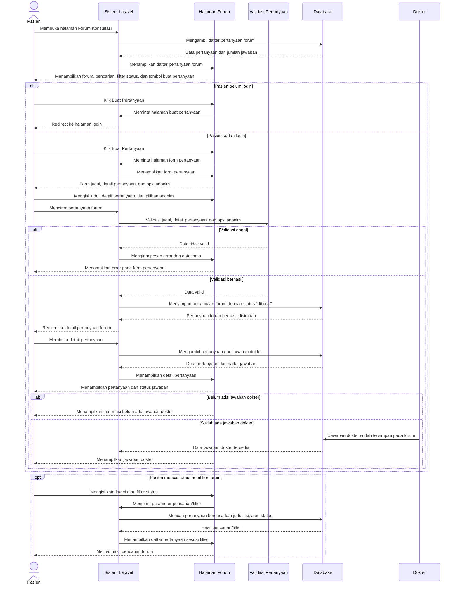

# Sequence Diagram Mengisi Forum Pra-Konsultasi (Pasien)

Alur mengisi forum pra-konsultasi dimulai saat pasien membuka halaman Forum Konsultasi dan sistem menampilkan daftar pertanyaan beserta jumlah jawaban dokter. Jika pasien belum login, sistem mengarahkan pasien ke halaman login ketika ingin membuat pertanyaan. Jika sudah login, pasien dapat membuka form, mengisi judul, detail pertanyaan, serta memilih apakah pertanyaan dikirim anonim. Sistem memvalidasi data, menyimpan pertanyaan ke tabel `forum_questions` dengan status `dibuka`, lalu mengarahkan pasien ke halaman detail pertanyaan. Pada halaman detail, pasien dapat melihat status pertanyaan dan jawaban dokter jika sudah tersedia.
