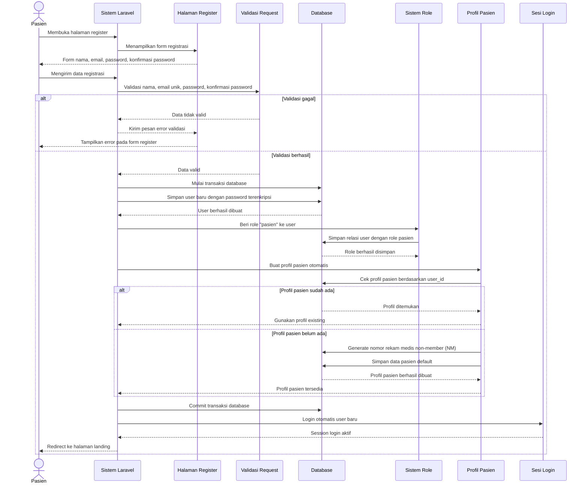

# Sequence Diagram Register

Alur register dimulai saat pasien membuka halaman pendaftaran dan mengisi nama, email, password, serta konfirmasi password. Sistem melakukan validasi data, termasuk email harus unik dan password harus sesuai aturan. Jika validasi gagal, pasien dikembalikan ke form dengan pesan error. Jika berhasil, sistem membuat data user, memberikan role pasien, membuat profil pasien otomatis dengan nomor rekam medis non-member, lalu melakukan login otomatis dan mengarahkan pasien ke halaman landing.
